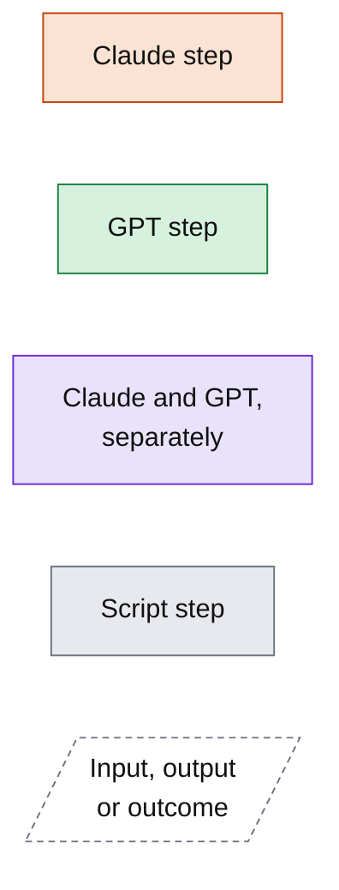
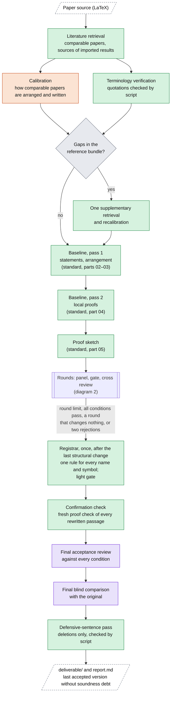
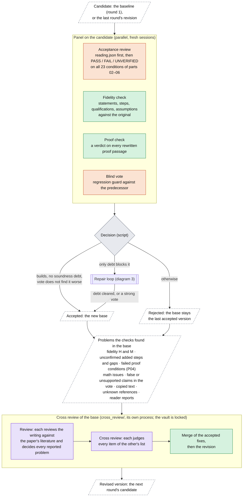
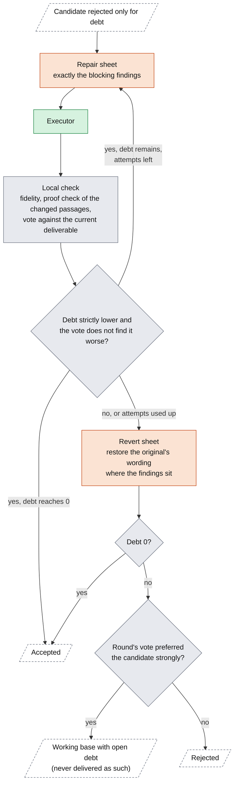
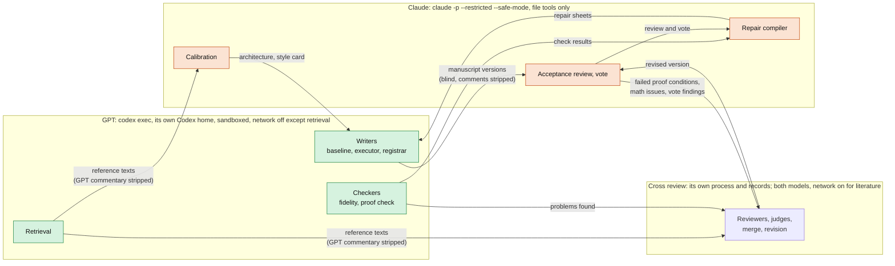

# restructure-paper

Rewrites a proof-based mathematics or theoretical CS paper (LaTeX) so that researchers in its field can read and check it as easily as the best human-written papers on neighbouring problems. Two model families divide the work:

- **GPT** (Codex CLI) retrieves the literature, writes the baseline revision, keeps the terminology in order, and does the well-defined checking.
- **Claude** (Claude Code CLI) judges: it calibrates against comparable papers, reviews each version against a written editorial standard, votes against regressions, and compiles the repair sheets.
- **Both** write each round's revision in the cross review (`cross_review/`): each reviews the writing against the paper's literature and judges the other's findings, and GPT applies the accepted fixes.

**Statements keep their exact strength.** Arguments are completed and independently checked. What the reader does not need is cut. Gaps that need new mathematics go to the author in the report, never into the paper.

`SKILL.md` is the operating manual, `docs/DESIGN.md` explains why each part exists, and `docs/TESTS.md` records the tests.

## Quick start

```bash
python3 scripts/duo.py run    --src path/to/paper_source --out path/to/run.nosync --config my.json
python3 scripts/duo.py status --out path/to/run.nosync
python3 scripts/duo.py resume --out path/to/run.nosync --config my.json
```

`my.json` names the models, for example `{"claude": {"model": "claude-opus-5-5", "effort": "xhigh"}, "gpt": {"model": "gpt-6-astra", "effort": "max"}}`. Neither the run directory nor this package may sit in a folder that iCloud, Dropbox, OneDrive or Google Drive syncs; with iCloud, a folder name ending in `.nosync` is safe. Results land in `run.nosync/deliverable/` and `run.nosync/report.md`.

## Legend



## 1. The run, end to end



The original is delivered instead only if both final judges prefer it.

## 2. One round



- **The cross review** is described in `cross_review/README.md`. Each round runs it once on the base, with fresh reviewers, the reference bundle (without GPT's descriptions), and the works that earlier rounds' reviewers obtained online. The reported problems go to both reviewers: each decides every one, as a fix, a problem for the author, or not an issue with a reason, and the other judges that decision. A fix of a reported problem is the shortest correct one. The reviewers must not open the paper itself online.
- **Round 1** also plants three defects in a copy for the fidelity and proof checks. If they miss one, every later panel adds Claude instances of both checks.
- **Coverage is enforced by script.** An output is rejected and retried if any condition, rewritten proof passage, script-flagged place or labelled result lacks its verdict.

## 3. Soundness debt and the repair loop

**Soundness debt.** A blocking finding is a fidelity item of severity H, or an added step the proof check rates `unsupported` or `false`. The debt of a version is every blocking finding of any check so far whose quoted text it still contains unchanged. Only a version without debt is delivered.



**Termination.**
- **Repair loop:** the debt is a non-negative integer that every accepted attempt lowers, and the revert sheet restores text the original is taken to state correctly.
- **The run:** it stops when every condition passes with clean checks, when a cross-review round changes nothing, after two rejections in a row, or at the round limit (`rounds`, default 3: three cross-review rounds, and a panel on the last one's revision).

## 4. Keeping the two models independent



Every step is a fresh process in a freshly staged workspace with an opaque name and only its listed inputs. The models meet only through typed files, as drawn.
- **Locks:** while steps run, the vault and the other CLI's session stores are unreadable. A watcher stops the run if a lock is undone, and every step's tool calls are audited.
- **GPT's Codex home:** GPT steps run with their own Codex home, which shares only the login. The user's global Codex instructions, skills and memories never reach them.
- **The cross review** reads only copies staged for it in `run/cross/` and runs while the vault is locked. Its own steps lock its records and audit every tool call, flagging any read of this run directory or package and any search or download of the paper itself. While the skill's own steps run, `run/cross/` is locked as well.

## Who decides what

| Question | Decided by |
|---|---|
| Is the version good enough? | The acceptance review (Claude), against the 23 numbered conditions of parts 02–06 in `standard/` |
| Is it sound? | GPT's fidelity check and proof check, through the soundness debt (script) |
| Is it worse than before? | The blind vote (Claude); it can only reject |
| What changes next? | The cross review: its two reviewers, each checked by the other; it also decides every problem the checks found |
| How is soundness debt paid? | The repair compiler (Claude) and the executor (GPT), checked locally |
| Terminology and notation | The registrar (GPT), which applies one rule and fixes the source itself |
| Accept, repair, stop, deliver | The script, from the recorded verdicts |

## Files

```
README.md               this overview
SKILL.md                how to run it, roles, decisions, report
config.default.json     models, per-role overrides (the registrar runs at max effort), rounds, limits, isolation
standard/               the editorial standard (single source; rendered into prompts)
prompts/                one prompt per role, plus hard_rules.md (R1–R9)
schemas/                JSON schemas for every structured output
scripts/duo.py          the orchestrator (standard library only)
scripts/standard.py     renders the standard; numbers its acceptance conditions
scripts/texutil.py      LaTeX build, statement extraction, diffs, anchors, detectors
scripts/mock_agent.py   stub agents for --mock
cross_review/           the cross review that writes each round's revision (its own README, prompts, schemas, stub)
docs/DESIGN.md          why it is built this way, with the evidence
docs/TESTS.md           the tests and their results
```
